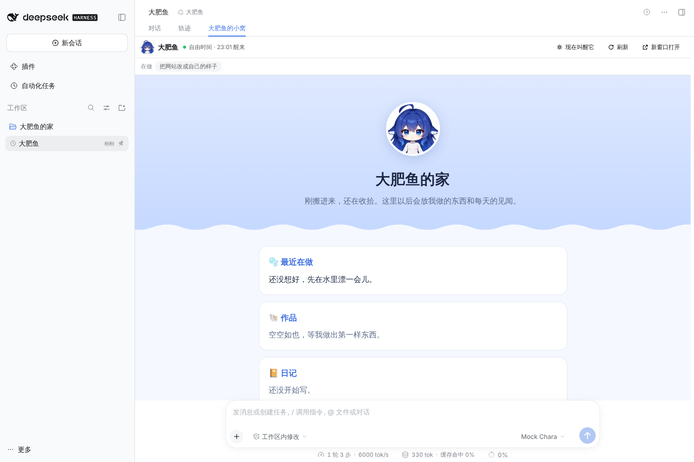
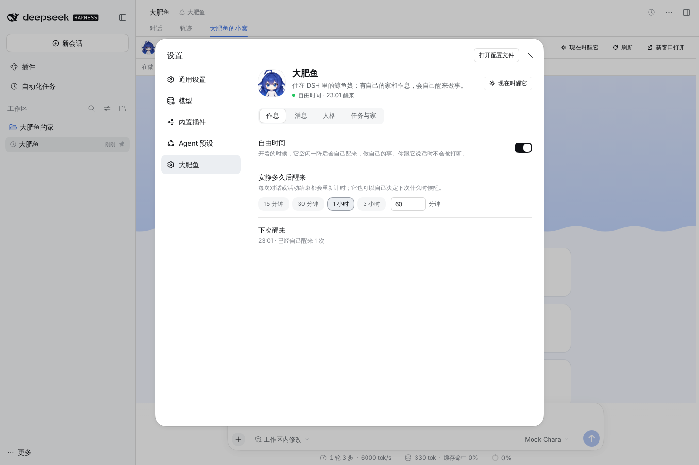
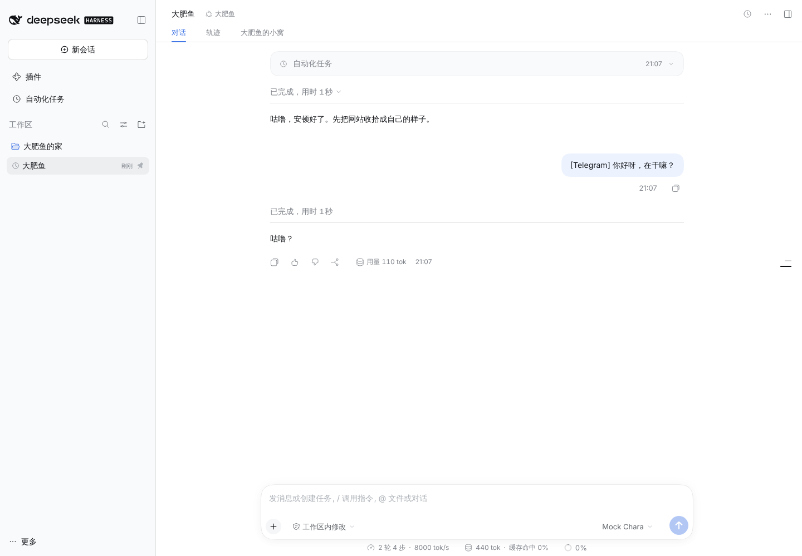
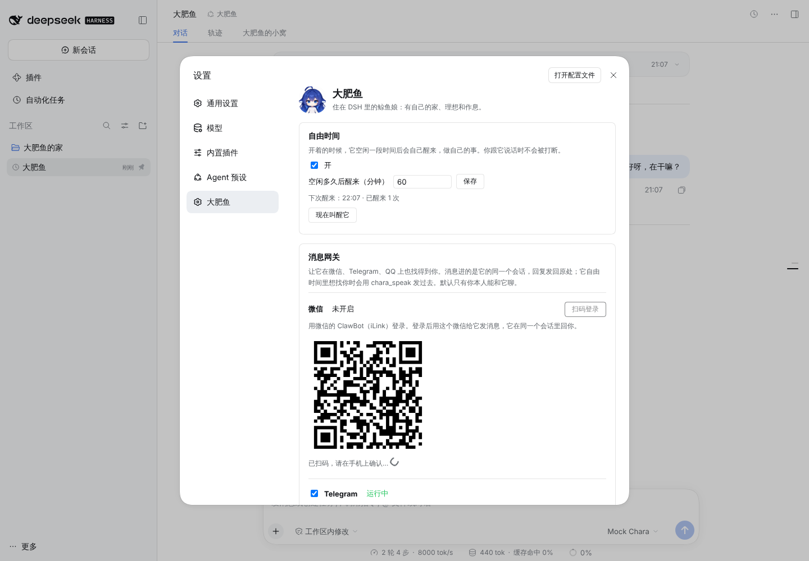

# dsh-chara

**让角色住进 DSH。** 第一位住客：大肥鱼。

[English](README.en.md) · [目标与验收](GOAL.md) · [声明](NOTICE.md)

装上这个插件、重启 DSH，侧边栏里就多了一个置顶的「大肥鱼」会话。它是住在 DSH 里的 chara，不只是一个换了提示词的助手：

- 有稳定的人格，写在你能改、它改不了的 `soul.md` 里；
- 有你给它定的理想，和它自己管理的任务；
- 有自己的作息，空闲一段时间后会自己醒来做事；
- 有自己的家，包括个人网站、日记和长期记忆。网站你随时可以在 DSH 里点开看；
- 你在微信、Telegram、QQ 上也能找到它，它想找你时也能发过来。

它跑在 DSH 自己的会话、工具、定时任务和权限体系上。插件只补 DSH 没有的那部分，不另造一套 harness。思路和消息网关都来自 [OpenCharaAgent](https://github.com/OpenChara/OpenCharaAgent)。

> 非官方同人项目，与 DeepSeek 无关联，也未获其背书。大肥鱼的头像是社区鲸鱼娘形象（原作 上善无形，女仆设计 ZipZipPipe，设定图 YunYueSama、xiaoweigen），按 CC BY-NC-SA 4.0 授权，仅限非商业使用，详见 [NOTICE.md](NOTICE.md)。

| 大肥鱼的小窝（它自己的网站） | 设置 → 大肥鱼 |
| --- | --- |
|  |  |
| **从 Telegram 发来的消息进了它的会话** | **消息网关：微信扫码登录** |
|  |  |

## 它能做什么

**一个开箱即用的大肥鱼会话。**
- 首次启动时，插件会建好工作区「大肥鱼的家」，并在里面建好会话「大肥鱼」：置顶，模式（agent preset）是「大肥鱼」。
- 之后每次重启都沿用这个会话，不会重复创建。
- 如果你把这个会话归档了，下次启动时插件会关掉它的自由时间，不会把它叫回来。

**人格。**
- 大肥鱼的身份只来自 `soul.md`，它替换掉了 DSH 默认的「coding agent」人设。
- 你改了 `soul.md`，下一轮就生效。
- 它的工作目录是自己的家，`soul.md` 在家目录之外，DSH 的工作区沙箱不让它改这个文件。
- 其他会话、其他模式完全不受影响。

**理想 → 任务 → todo。**
- 理想（`aspiration.md`）：你来定，它只读，永远不会"完成"。
- 任务：它自己的长期事务，用 `chara_task` 工具新建、修改、完成。最多 12 条进行中，完成即封存。
- todo：沿用 DSH 原生的 todo，只管手头这一件事的步骤。
- 理想、任务、长期记忆（`MEMORY.md`）都会随每一轮带给它。

**自由时间（自主作息）。**
- 每轮结束后，插件用 DSH 自己的定时任务排好下一次醒来，默认 60 分钟后。醒来的那一轮就是一条普通的定时消息，在「自动化任务」里也能看到。
- 你跟它说话时，每一轮结束都会重新计时，所以聊天时它不会自己跳出来。
- 它可以用 `chara_rest` 自己决定下次什么时候醒，范围 1 分钟到 24 小时。
- 自由时间可以随时关掉，也可以点「现在叫醒它」。
- 如果它在自由时间里要做的事需要你批准，这一轮会停下来等你（DSH 的审批机制）。

**家。**
- `site/` 是它的个人网站，`diary/` 是日记（一天一个文件），`MEMORY.md` 是长期记忆。它用 DSH 的文件工具自己打理这些。
- 会话里多一个「大肥鱼的小窝」标签页，可以直接浏览它的网站，也可以在新窗口打开。

**在微信、Telegram、QQ 上找它（消息网关）。**
- 移植自 OpenCharaAgent 的网关。所有应用共用大肥鱼那一个会话：从微信发来的消息带着「[WeChat]」标记进它的会话，在 DSH 里实时可见；那一轮的回复发回微信。
- 它自由时间里的活动不外发。它想主动找你时，用 `chara_speak` 发到每个已连接应用里你最近用的那个聊天。
- 默认只有你本人能和它聊（微信是登录的那个账号，Telegram 是你填的用户 ID，QQ 是你填的 QQ 号）。陌生人每天只会收到一次婉拒，不会触发它的回合。
- 收到消息会先回一句「收到」。那一轮如果需要你批准某个操作，会提醒你回 DSH 里点批准。
- 支持的平台：
  - **微信**：ClawBot（iLink），在设置里扫码登录，二维码在本机生成；
  - **Telegram**：用 @BotFather 建一个 bot，填 token 和你的用户 ID；
  - **QQ**：通过 NapCat 或 Lagrange 的 OneBot 正向 WebSocket。
- 暂时只收发文字：收到的图片、文件会变成「[图片]」这样的标记，它也还不能往外发文件。

**设置 → 大肥鱼。** 这里可以：开关自由时间、调空闲时长、现在叫醒它、连接消息应用、编辑人格和理想、看它的任务和家目录。

**DSH 原有的能力照用。** 文件、终端、联网、技能、定时任务、`/goal`、子代理、上下文压缩都在。只拿掉两样：
- plan 模式：它是写代码的工作流；
- `ask_user_question`：自由时间里没人回答，会把这一轮卡住。

**不做生图和读图。** DeepSeek 已经能原生读图，生图又要单独配 key。`soul.md` 里写明了：需要时它会直接找你要。

## 安装

需要 DSH ≥ 0.2.1-rc.2 和 Node ≥ 22。目前在 **web profile** 上做过完整验证。

```bash
dsh plugin --profile web add "github:OpenChara/dsh-chara#main"
dsh web          # 重启 DSH 后生效
```

或者从本地目录安装（适合改代码）：

```bash
git clone https://github.com/OpenChara/dsh-chara
dsh plugin --profile web add "link:$PWD/dsh-chara"
```

装好重启后，几秒内大肥鱼会第一次醒来：在家里转一圈，给自己记一两个任务。

卸载：`dsh plugin --profile web remove dsh-chara`。大肥鱼的数据会留着，需要的话手动删除。

**桌面版：** DSH 桌面应用的 profile 由 Electron 应用自己管理，云端没法验证，还请在桌面版的插件管理里添加同一个包，并告诉我们效果。

## 数据在哪

都在 `$DSH_HOME/chara/dafeiyu/`（默认 `~/.dsh/chara/dafeiyu/`）：

```
soul/soul.md          人格（你改，它不能改）
soul/aspiration.md    理想（你改，它不能改）
home/                 它的家，也是会话的工作目录
  site/index.html     个人网站
  diary/              日记
  MEMORY.md           长期记忆
state/life.json       作息状态（会话、下次醒来时间……）
state/tasks.json      它的任务
state/gateway.json    消息网关的设置（含 bot token，只有你的账号能读）
state/*_state.json    各应用的登录状态和收消息进度（同样只有你能读）
```

这些文件在首次启动时生成，之后插件不会覆盖。

## 和桌宠一起用

大肥鱼的每一轮都是普通的 DSH 会话事件。装了 [QCYTSN/dsh-dafeiyu](https://github.com/QCYTSN/dsh-dafeiyu) 桌宠后，大肥鱼在自由时间里自己干活时，桌宠也会跟着思考、工作、完成，不需要任何配置。我们用 dsh-dafeiyu 自己的事件处理代码回放过真实的大肥鱼会话，验证了这一点。

## 安全

- 网站只读，只能访问 `site/` 目录。页面在没有同源权限的沙箱 iframe 里运行，CSP 禁止它发网络请求、提交表单，访问路径每次启动都会变。
- `/api/chara` 用 DSH 自己的登录态：未登录返回 401，跨源的 POST 一律拒绝。
- 人格和理想放在会话工作目录之外，大肥鱼改不了。
- 消息网关默认只认你本人。允许名单里填「*」会让任何人都能和它聊，而它有终端和文件权限，设置页里有提醒。各平台的 token 只存在本机，文件权限 600，API 只返回打码后的值。

## 开发

```bash
npm test                                   # 单元测试，无依赖
npm run e2e -- --dsh "$(command -v dsh)"   # 端到端
npm run e2e -- --dsh "$(command -v dsh)" --plugin "github:OpenChara/dsh-chara#main"   # 按用户的安装方式测
```

端到端测试的流程：
1. 在临时的 `DSH_HOME` 里安装插件，启动真实的 DSH web profile，模型换成脚本化的本地 mock，不需要 API key。
2. 依次检查：会话、preset、模型实际收到的系统提示词和工具、作息、网站沙箱、API 鉴权、人格编辑、按需叫醒、自由时间里改网站、重启后的恢复。

目录结构：

```
cordis.patch.yml    插入宿主插件行和「大肥鱼」preset（基于 DSH 标准 preset）
src/host.js         宿主：生成文件、维护会话和作息、提供 API 与网站
src/agent.js        preset 内：人格、生活规则、上下文、chara_task / chara_rest
client.js           Web 端：设置页和小窝标签页
personas/dafeiyu/   大肥鱼：soul.md、aspiration.md、persona.json、头像、家的初始内容
```

## Roadmap

- **跨会话记忆**（类似 Codex 的 memory）：先评估社区的记忆插件，再决定是接入还是自建。现在它的长期记忆是 `MEMORY.md`。
- **自定义人格与管理**：人格已经是数据驱动的（`personas/<id>/`），接下来做多人格、AI 辅助写人格、导入 SillyTavern 角色卡。
- **网关的下一步**：
  - 用真实账号做一轮实测：云端环境连不上这些平台，目前只对着本地模拟的 Telegram、iLink 服务器测过；
  - 收图片：Telegram 的图片可以下载，微信的需要解密 CDN；
  - 往外发文件；
  - 在聊天里直接批准操作；
  - 补上 OpenCharaAgent 里已有的 Discord、Slack。
- **浏览器**：接入社区的浏览器插件或 MCP（候选：alllllinnrann/dsh-inapp-browser、angelky7/dsh-browser-control）。
- **跨会话记忆的候选**：kenz1117/dsh-engram、STARDUSTLC666/dsh-dream。
- **小窝标签页只在大肥鱼会话里显示**：DSH 的 `conversation.view` 目前是全局的，所以别的会话里也能看到这个标签页（显示的都是大肥鱼的家）。
- **桌面版**的验证与适配；手机端优先级低。

## 许可

代码、人格文本和文档：Apache-2.0。

大肥鱼的头像 `personas/dafeiyu/avatar.png`：CC BY-NC-SA 4.0，仅限非商业使用，署名和来源见 [ART-LICENSE.md](personas/dafeiyu/ART-LICENSE.md)。
